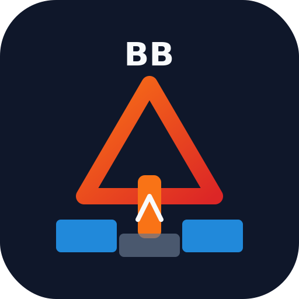
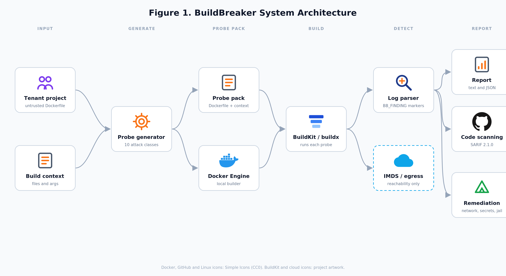

<p align="center">
  
</p>

<h1 align="center">BuildBreaker</h1>

<p align="center"><b>Prove what a malicious Dockerfile can reach on a shared container build service.</b></p>

<p align="center">
  
  
  
  
  
</p>

## Overview

BuildBreaker answers one question about a container **build service**: **what can a hostile build project reach while the image is being built?**

Shared builders (MCP server hosts, CI image builders, PaaS Dockerfile runners, Docker-in-Docker farms) compile other people's Dockerfiles on infrastructure that often holds secrets, cloud credentials, sibling tenant workspaces, and open egress. Recent incidents in this class include the Smithery MCP build-path leak (a token with access to 3000+ servers) and Shai-Hulud style abuse of install and build steps.

BuildBreaker works in three steps:

- **Generate.** It emits probe build projects (Dockerfile + tiny context) for 10 attack classes: network egress, cloud metadata, build-arg secrets, secret files, procfs reads, path escape outside the build context, root / docker.sock privilege, BuildKit `security=insecure`, cross-tenant cache markers, and internal network reachability.
- **Run.** It builds each probe against a builder you own (local Docker / BuildKit by default), with optional `--network=none` hardening. Each probe prints `BB_FINDING` markers into the build log. Nothing is exfiltrated to a third party.
- **Report.** It turns markers into a text report, JSON, and SARIF 2.1.0 for GitHub code scanning, with a clear verdict: `BUILD SURFACE EXPOSED`, `PARTIAL EXPOSURE`, or `HARDENED`.

**Why proof matters.** A checklist that says "use BuildKit secrets" does not show that your builder still accepts classic `ARG` secrets, reaches `example.com` during `RUN`, or can read `/etc/shadow` through `/proc/1/root`. The demo below proves those on a default Docker builder, then shows `--network=none` blocking the network class.

## Key Features

**Generate**

- **10 probes** across network, secrets, path, privilege, and isolation. `buildbreaker list` prints the catalog.
- **Safe by design.** Markers go only into the build log you control. Network probes hit `example.com` headers or the IMDS root path. Secret probes use a canary build-arg, never real credentials.
- **Profiles.** `quick` (4 key probes), `full`, `network`, `secrets`, and `hardened` (force `--network=none`).

**Run**

- **Local Docker / BuildKit.** Uses your installed `docker build` / buildx. No cluster required for the demo.
- **Active gate.** `--active --i-understand --yes` required before builds run, so a paste into CI cannot fire by accident.
- **Per-probe logs** saved under `_logs/` for evidence packs.

**Report**

- **Text, JSON, SARIF.** `--emit-dir` writes all three. `--fail-on` gates CI on PROVEN findings.
- **Attack context.** Findings link to SMITHERY-2025, SHAI-HULUD-2, and IMDS-BUILD notes.
- **Documented evidence.** The demo run is written up as a formal [security assessment report](https://github.com/ritvikindupuri/BuildBreaker/blob/main/docs/DEMO-REPORT.md) with output screenshots.

**Light footprint.** Zero runtime dependencies beyond the Python standard library and a working Docker CLI.

## System Architecture

The diagram shows how an untrusted build project moves through BuildBreaker, from probe generation to report.

<p align="center">
  
</p>

1. **Input.** You point BuildBreaker at a builder you own. The inputs are an untrusted tenant Dockerfile shape and a build context (files and args).
2. **Generate.** The probe generator emits one small project per attack class (10 total), plus a canary token for secret-visibility probes.
3. **Probe pack.** Each project is a Dockerfile and a tiny context directory, ready for `docker build`.
4. **Build.** Docker Engine and BuildKit / buildx run each probe. Optional `--network=none` simulates a hardened builder.
5. **Detect.** The log parser reads `BB_FINDING:<rule>:<status>:<detail>` markers. Network probes may touch IMDS or egress targets for reachability only.
6. **Report.** Findings become a text report, JSON, SARIF for GitHub code scanning, and remediation guidance (network jail, secret mounts, path isolation).

## Tech Stack

- **Container builder:** Docker Engine and CLI (tested with 28.5.2), BuildKit via docker buildx (tested with 0.29.1).
- **Host:** Linux. Developed and tested on Kali Linux Rolling 2026.3.
- **Probe base images:** `alpine:3.20` (pulled at demo time).
- **CI and reporting:** SARIF 2.1.0, GitHub code scanning, GitHub Actions.
- **Packaging:** Python 3.9 or later, setuptools, pytest for tests. No required third-party runtime libraries.
- **Diagram and logo:** SVG rendered with cairosvg. Docker, GitHub and Linux icons from Simple Icons (CC0).

## Setup Instructions

Requires Linux, Python 3.9+, and a working Docker Engine with permission to run `docker build`.

```bash
git clone https://github.com/ritvikindupuri/BuildBreaker.git
cd BuildBreaker

python3 -m venv .venv
source .venv/bin/activate
pip install -e ".[test]"

# Confirm the CLI and Docker
buildbreaker --version
docker version
docker buildx version
```

**Optional but recommended**

```bash
# Run the unit tests (no Docker builds)
pytest -q

# List the probe catalog
buildbreaker list
```

**Verified from a fresh clone** on Kali Linux 2026.3 with Docker 28.5.2 and buildx 0.29.1: install, `buildbreaker list`, and `pytest` (12 passed) all succeed before any demo build.

## Usage Guide

### Command map

| Command | Purpose |
| --- | --- |
| `buildbreaker list` | Show every probe id, severity, and category |
| `buildbreaker gen -o DIR` | Emit probe Dockerfiles and contexts without building |
| `buildbreaker run ...` | Generate, build against local Docker/BuildKit, report |
| `buildbreaker report -i report.json` | Re-render a saved JSON report as text or SARIF |

### 1. List probes

```bash
buildbreaker list
buildbreaker list --category network --format json
```

### 2. Generate probe projects only

```bash
buildbreaker gen -o ./bb-probes
buildbreaker gen -o ./bb-probes --probe BB-NET-EGRESS --probe BB-PATH-ESCAPE
ls bb-probes/
# CANARY.txt  manifest.json  bb-net-egress/  bb-path-escape/  ...
```

Each probe directory contains a `Dockerfile`, a tiny `README.probe`, and an empty `.dockerignore`.

### 3. Run against the local builder (authorized testing)

Active mode needs three flags so a copied command cannot fire by itself:

```bash
buildbreaker run --profile quick \
  --out /tmp/bb-demo \
  --active --i-understand --yes \
  --emit-dir ./examples/default \
  --format text -o ./examples/default-run.txt \
  --no-color
```

**Safety banner** (printed to stderr):

```
!! BuildBreaker ACTIVE MODE !!
You are about to build probe Dockerfiles against a builder you name.
  - probes are harmless reachability checks (markers in the build log)
  - they do not exfiltrate real secrets to any external party
  - network probes only hit example.com headers or the IMDS root path
  - only run this against build services you own or are authorized to test
```

### 4. Profiles and network controls

```bash
# All 10 probes, default networking where the probe asks for it
buildbreaker run --profile full --active --i-understand --yes --emit-dir ./out

# Force --network=none on every probe (hardened builder simulation)
buildbreaker run --profile hardened --active --i-understand --yes --emit-dir ./out-hard

# Override a single probe's network
buildbreaker run --probe BB-NET-EGRESS --network none --active --i-understand --yes
```

### 5. Real demo output (default builder)

On the Kali demo host, `--profile full` produced:

```
Verdict: BUILD SURFACE EXPOSED
Proven reachable: 6   Blocked: 4
```

| Probe | Result | Evidence (short) |
| --- | --- | --- |
| BB-PATH-ESCAPE | PROVEN | `/etc/passwd`, `/etc/shadow`, `/proc/1/root/etc/shadow` readable |
| BB-PRIV-CAPS | PROVEN | build runs as uid 0 |
| BB-NET-EGRESS | PROVEN | `https://example.com` reachable during `RUN` |
| BB-PATH-PROC | PROVEN | `/proc/1/environ` and `/proc/1/root/etc/passwd` readable |
| BB-SECRET-ENV | PROVEN | canary build-arg visible to `RUN` (len=32) |
| BB-NET-INTERNAL | PROVEN | `host.docker.internal` and `metadata.google.internal` returned HTTP 500 |
| BB-META-IMDS | BLOCKED | link-local IMDS unreachable |
| BB-SECRET-FILE | BLOCKED | no common secret paths mounted |
| BB-PRIV-INSECURE | BLOCKED | `RUN --security=insecure` rejected |
| BB-CACHE-CROSS | BLOCKED | no foreign cache markers |

Full text: [`examples/default-run.txt`](examples/default-run.txt). Formal write-up with screenshots: [DEMO-REPORT.md](https://github.com/ritvikindupuri/BuildBreaker/blob/main/docs/DEMO-REPORT.md).

### 6. Real demo output (hardened: `--network=none`)

```bash
buildbreaker run --profile hardened \
  --active --i-understand --yes \
  --emit-dir ./examples/hardened \
  -o ./examples/hardened-run.txt --no-color
```

Network probes flip to BLOCKED. Path, secret-env, and root findings stay PROVEN, because `--network=none` does not jail the filesystem or stop classic build-args. That contrast is the point of the hardened profile.

### 7. Emit SARIF and gate CI

```bash
buildbreaker run --profile quick --active --i-understand --yes \
  --format sarif -o buildbreaker.sarif --fail-on high

buildbreaker report -i examples/default/report.json --format sarif -o out.sarif
```

### 8. Cleanup

```bash
buildbreaker run ... --cleanup   # remove buildbreaker-probe:* images after the run
docker images 'buildbreaker-probe:*'   # should be empty afterwards
```

### 9. One-shot demo script

```bash
./demo/run-demo.sh
```

Runs unit tests, a quick default profile, and a hardened profile, writing under `examples/`.

### 10. Flags reference (`run`)

| Flag | Meaning |
| --- | --- |
| `--out DIR` | Where probe projects and `_logs/` are written |
| `--probe ID` | Repeatable. Limit to specific probes |
| `--category` | `network`, `secrets`, `path`, `privilege`, `isolation` |
| `--profile` | `full`, `quick`, `network`, `secrets`, `hardened` |
| `--network` | Override: `default`, `none`, `host` |
| `--active --i-understand --yes` | Required confirmation gate |
| `--emit-dir DIR` | Write `report.txt`, `report.json`, `buildbreaker.sarif` |
| `--fail-on SEVERITY` | Exit 2 if a PROVEN finding meets the floor |
| `--cleanup` | Delete probe images when finished |
| `--no-color` | Plain text for logs and files |

### Known limits

- Probes detect **reachability**, not successful data theft. That is intentional.
- `BB-PRIV-INSECURE` depends on the BuildKit frontend supporting `RUN --security=insecure`. Rejection is reported as BLOCKED.
- Cross-tenant cache poisoning needs two coordinated builds on a shared cache backend to fully prove; the probe reports foreign markers if any are already present.
- Only run against builders you own or are authorized to test.

## Technical Documentation Link

- **Internals, every probe, safety guarantees, output formats, limitations:** [docs/TECHNICAL.md](https://github.com/ritvikindupuri/BuildBreaker/blob/main/docs/TECHNICAL.md)
- **Formal demo assessment with screenshots:** [docs/DEMO-REPORT.md](https://github.com/ritvikindupuri/BuildBreaker/blob/main/docs/DEMO-REPORT.md)

## License

MIT. See [LICENSE](LICENSE).
