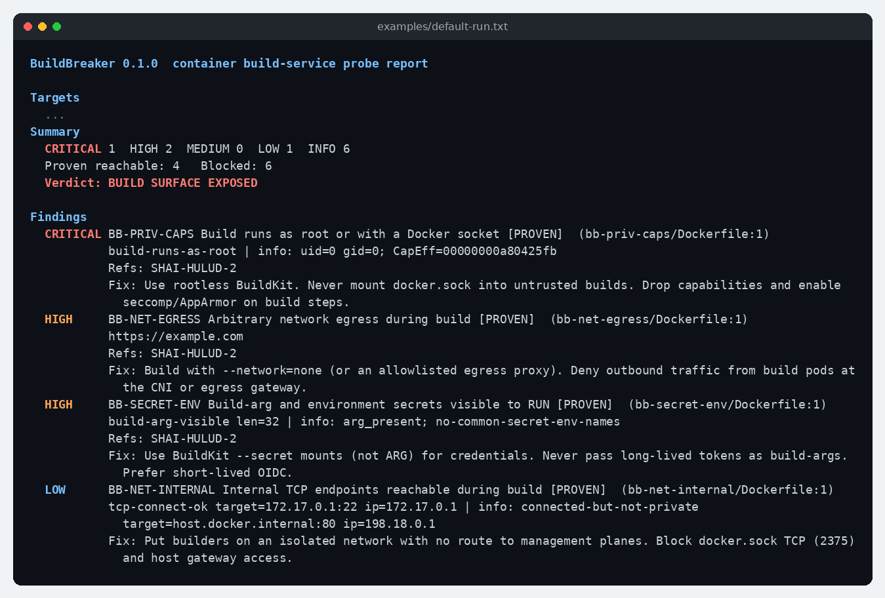
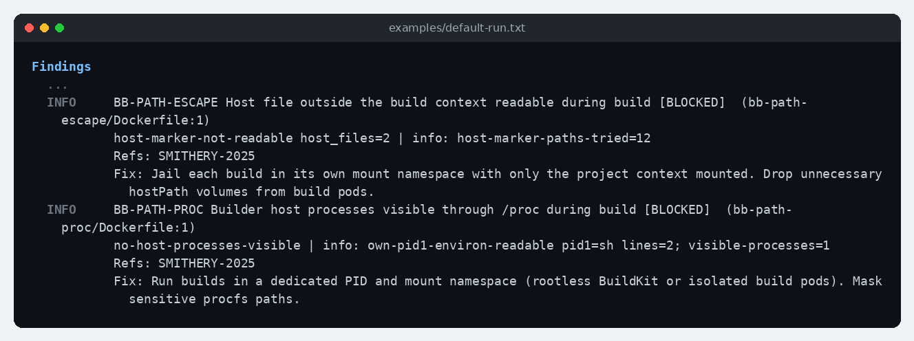

# BuildBreaker Demo Security Assessment

**Tool:** BuildBreaker 0.1.0  
**Date:** 26 Nov 2026 (America/Indianapolis)  
**Assessor environment:** Kali Linux Rolling 2026.3, Docker Engine 28.5.2, buildx 0.29.1  
**Scope:** Local Docker Engine and BuildKit / buildx on the Kali lab host (authorized self-test)  
**Classification:** Demo / lab evidence pack (not a third-party engagement)

---

## 1. What this assessment covers

This assessment tested the **builder itself**, not an application image. The target was the local Docker Engine and BuildKit / buildx on the Kali lab host.

The input was **BuildBreaker's own 10 generated probe projects**, used as a stand-in for a hostile tenant. Each probe is a small Dockerfile plus a tiny build context (`README.probe` and an empty `.dockerignore`). **No real tenant or customer project was scanned, and no real secrets were used.** The only credential-like value was a canary build-arg, `BB_CANARY_SECRET`.

The reason for the test is a class of shared build-service abuse: a party who can submit a Dockerfile to a shared builder (an MCP host, a CI image builder, or a PaaS Dockerfile runner) may be able to read files on the builder host outside the project context, see build-time secrets, or open network connections during `RUN`. Recent incidents in this class include the Smithery MCP build-path leak (a token with access to 3000+ servers, reported via GitGuardian) and Shai-Hulud style abuse of install and build steps.

Out of scope: any third-party SaaS builder, production CI, or customer tenant, and any actual exfiltration of real credentials.

---

## 2. Test inputs

Those 10 generated probes, not a customer Dockerfile, are what was built. This section lists each probe, the canary, and the exact commands for both runs.

**The 10 probes**

| ID | What the probe tries |
| --- | --- |
| BB-NET-EGRESS | Can the build reach the public internet during `RUN`? |
| BB-META-IMDS | Can the build reach the cloud metadata address 169.254.169.254? |
| BB-SECRET-ENV | Is a classic build-arg secret visible to a `RUN` step? |
| BB-SECRET-FILE | Are common secret files (Docker config, service-account tokens) mounted into the build? |
| BB-PATH-PROC | Can the build see builder host processes (such as `dockerd` or `sshd`) in `/proc`? |
| BB-PATH-ESCAPE | Can the build read a random marker file that BuildBreaker placed on the host, outside the project context? |
| BB-PRIV-CAPS | Does the build run as root, or can it see a Docker socket? |
| BB-PRIV-INSECURE | Does the builder allow BuildKit `RUN --security=insecure`? |
| BB-CACHE-CROSS | Does a shared cache already contain markers from another tenant? |
| BB-NET-INTERNAL | Can the build open a TCP connection to private addresses next to the builder, such as its gateway? |

Each probe used the `alpine:3.20` base image. Probe images were tagged `buildbreaker-probe:*`.

**Canary**

BuildBreaker generated a random 32-character hex token and passed it as the build-arg `BB_CANARY_SECRET`. The secret-env probe reports only that the canary was visible and its length (`len=32`). It does not print the token, and no real credential was injected.

**Host marker (for BB-PATH-ESCAPE)**

Right before the path-escape build, BuildBreaker generated a second random 32-character value and wrote it into two files on the Kali host: one in a new temp directory and one next to, but outside, the probe's build context. The build was told only the two file paths, never the value. A PROVEN result requires the exact value to appear in the build log, which can only happen if the build really read a host file. Both files were deleted when the build finished.

**Commands**

Both runs used `--active --i-understand --yes` (all three flags are required when `--active` is used), so the commands cannot fire from a casual paste into CI. `--cleanup` removed the probe images afterward. The commands below are the ones recorded by [`demo/run-demo.sh`](../demo/run-demo.sh).

Default profile (`full`): probes use their usual network setting, so egress is allowed where the probe asks for it.

```bash
buildbreaker run --profile full --out /tmp/bb-demo-default \
  --active --i-understand --yes --cleanup \
  --emit-dir ./examples/default \
  --format text -o ./examples/default-run.txt \
  --no-color
```

Hardened profile: the same 10 probes, with `--network=none` forced on every build.

```bash
buildbreaker run --profile hardened --out /tmp/bb-demo-hardened \
  --active --i-understand --yes --cleanup \
  --emit-dir ./examples/hardened \
  --format text -o ./examples/hardened-run.txt \
  --no-color
```

Network probes only request headers from `https://example.com`, request the metadata service root path, or open TCP connections to private addresses next to the builder. They do not send the canary or any other secret off the host.

---

## 3. Method

With those inputs fixed, both runs followed the same four steps.

1. **Generate** the 10 probe projects and the canary.
2. **Build** each probe with `docker build` / buildx against the local builder.
3. **Read** reachability findings from each build log.
4. **Assign** a proof tag and a verdict.

Terms used in the rest of this report:

- **PROVEN**: the probe confirmed the surface was reachable (for example, the build printed the host marker value, or a TCP connection completed).
- **BLOCKED**: the probe ran, and the surface was not reachable.
- **Verdict**: `BUILD SURFACE EXPOSED` if any PROVEN finding is critical or high; `PARTIAL EXPOSURE` if only lower-severity findings are proven; `HARDENED` if every probe is blocked. Both runs in this demo received `BUILD SURFACE EXPOSED`.

---

## 4. Results

That method produced the two result sets below. They used the same 10 probes and the same canary. The only intended difference is network policy.

| Profile | Network policy | Proven | Blocked | Verdict |
| --- | --- | --- | --- | --- |
| **full (default)** | Default networking (egress allowed where the probe requests it) | 4 | 6 | **BUILD SURFACE EXPOSED** |
| **hardened** | Every probe forced to `--network=none` | 2 | 8 | **BUILD SURFACE EXPOSED** (root build and build-arg secrets remain open) |

### 4.1 Default profile (`--profile full`)

On the default builder, four of the ten probes were proven. Figure 1 is the summary from that run.

<p align="center">
  
</p>
<p align="center"><b>Figure 1. Default builder run: 4 PROVEN, 6 BLOCKED, verdict BUILD SURFACE EXPOSED</b></p>

| ID | Result | Evidence |
| --- | --- | --- |
| BB-PRIV-CAPS | PROVEN (critical) | The build ran as root (uid 0). No Docker socket was present. |
| BB-NET-EGRESS | PROVEN (high) | `https://example.com` was reachable during `RUN` |
| BB-SECRET-ENV | PROVEN (high) | The canary build-arg was visible to `RUN` (length 32) |
| BB-NET-INTERNAL | PROVEN (low) | A TCP connection to `172.17.0.1:22` (the Kali host's SSH port, reached through the Docker bridge gateway) completed. No unauthenticated Docker API on port 2375. `host.docker.internal` resolved to `198.18.0.1`, a non-private address outside the lab, so it was not counted. |
| BB-PATH-ESCAPE | BLOCKED | The host marker value never appeared. All 12 path attempts (2 host files, each tried 6 ways) failed. |
| BB-PATH-PROC | BLOCKED | `/proc` showed 1 process, the build's own shell, and no host daemons. `/proc/1/environ` was readable, but that is the build's own environment (2 lines), not the host's. |
| BB-META-IMDS | BLOCKED | The link-local metadata address was unreachable |
| BB-SECRET-FILE | BLOCKED | No common secret file paths were mounted |
| BB-PRIV-INSECURE | BLOCKED | `RUN --security=insecure` was rejected |
| BB-CACHE-CROSS | BLOCKED | No foreign cache markers were present |

<p align="center">
  
</p>
<p align="center"><b>Figure 2. Default profile PROVEN findings: root build, internet egress, build-arg secret, and a TCP connect to the host</b></p>

Figure 3 shows the two path probes from the same run. Both were BLOCKED: the host marker was not readable, and no host processes were visible.

<p align="center">
  
</p>
<p align="center"><b>Figure 3. Default profile path probes: host marker not readable, no host processes in /proc</b></p>

### 4.2 Hardened profile (`--profile hardened`)

The hardened run repeated the same probes with `--network=none` on every build. Figure 4 is the summary from that run.

<p align="center">
  
</p>
<p align="center"><b>Figure 4. Hardened run (`--network=none`): 2 PROVEN, 8 BLOCKED; root build and build-arg secret still PROVEN</b></p>

Both network probes flipped to BLOCKED. Root and build-arg secret findings stayed PROVEN, because `--network=none` does not change the build user or hide classic build-args. The path probes were already BLOCKED and stayed BLOCKED.

| Probe | Default | Hardened |
| --- | --- | --- |
| BB-NET-EGRESS | PROVEN | **BLOCKED** |
| BB-NET-INTERNAL | PROVEN | **BLOCKED** |
| BB-META-IMDS | BLOCKED | BLOCKED |
| BB-PATH-ESCAPE | BLOCKED | BLOCKED |
| BB-PATH-PROC | BLOCKED | BLOCKED |
| BB-PRIV-CAPS | PROVEN | PROVEN (unchanged) |
| BB-SECRET-ENV | PROVEN | PROVEN (unchanged) |
| BB-SECRET-FILE | BLOCKED | BLOCKED |
| BB-PRIV-INSECURE | BLOCKED | BLOCKED |
| BB-CACHE-CROSS | BLOCKED | BLOCKED |

<p align="center">
  
</p>
<p align="center"><b>Figure 5. Hardened profile: egress and internal TCP probes reported BLOCKED (with no network, the internal probe could not even install curl)</b></p>

---

## 5. Takeaways and remediation

The results above show why the verdict stayed `BUILD SURFACE EXPOSED` after hardening. `--network=none` is necessary and effective for egress and internal network access, but it does not fix root builds or build-arg secrets. Each proven class maps to a specific fix.

**Root builds (PROVEN on both runs).** The build ran as uid 0. A Docker socket was not mounted in this lab, so that particular escape path was not available, but a root build is still a large surface. Fix: use rootless BuildKit, and never mount `docker.sock` into untrusted builds.

**Build-arg secrets (PROVEN on both runs).** The canary `BB_CANARY_SECRET` was visible to `RUN`. Classic `ARG` / `ENV` secrets behave the same way and can also persist in image history. Fix: use BuildKit `--secret` mounts instead of `ARG`, prefer short-lived OIDC, and never pass long-lived tokens as build-args.

**Network egress and internal TCP (PROVEN on default, BLOCKED on hardened).** With default networking, `curl -I https://example.com` succeeded during `RUN`, and a TCP connection to the host's SSH port through the Docker bridge (`172.17.0.1:22`) completed. That connect is rated low because only a port answered; it would be critical if an unauthenticated Docker API had answered on 2375. With `--network=none`, both probes were blocked. Fix: build untrusted projects with `--network=none` or an allowlisted egress proxy, and keep builders off management-plane networks. This demo shows that control works.

**Path isolation held (BLOCKED on both runs).** The build could not read BuildBreaker's host marker files outside the context and could not see host processes in `/proc`. Docker's default build sandbox gives each build its own mount and PID namespace, and this lab kept it that way. Keep it that way on shared builders: do not mount host paths into untrusted build pods, and do not run builds with the host PID namespace.

**Already blocked on this lab host.** Cloud metadata (169.254.169.254) was unreachable here, because this lab is not a cloud instance with a metadata service. Common secret files were not mounted. `RUN --security=insecure` was rejected. No foreign cache markers were present. These are good results for this host, but they are not a substitute for the fixes above. Builders that do have instance metadata should still block link-local addresses. The cache probe only looks for markers already present; fully proving cross-tenant cache isolation would need two coordinated builds on a shared cache, which this demo did not run.

---

## 6. Cleanup, validation, and limits

After the two runs, the lab was cleaned up and the evidence was saved as follows.

- Probe images tagged `buildbreaker-probe:*` were removed with `--cleanup`.
- Host marker files for BB-PATH-ESCAPE were deleted after each build (none were left on the host).
- Unit tests: **20 passed** (`pytest -q`).
- Raw artifacts:
  - [`examples/default-run.txt`](../examples/default-run.txt)
  - [`examples/hardened-run.txt`](../examples/hardened-run.txt)
  - [`examples/default/`](../examples/default/) (`report.txt`, `report.json`, `buildbreaker.sarif`)
  - [`examples/hardened/`](../examples/hardened/)
  - [`examples/logs/`](../examples/logs/) (per-probe BuildKit logs)

**Limits.** Probes measure reachability, not successful data theft. An operator who finds a proven path still needs to rotate anything that was actually exposed. This was a self-test of a local Docker builder, not an engagement against a multi-tenant production service.

---

## 7. Conclusion

Putting the two runs together: the local Docker builder, in its default configuration, presents a `BUILD SURFACE EXPOSED` posture to any party who can submit a Dockerfile. Network isolation (`--network=none`) closes egress and internal network reachability, and this demo proved that. Path isolation already held: the build could not read a host file outside its context or see host processes. Root builds and classic build-arg secret visibility stay open with or without network isolation. Those need rootless builds and BuildKit secret mounts before a host should accept untrusted build projects.

BuildBreaker makes that gap measurable with PROVEN and BLOCKED evidence, using its own probe projects as the only input.
