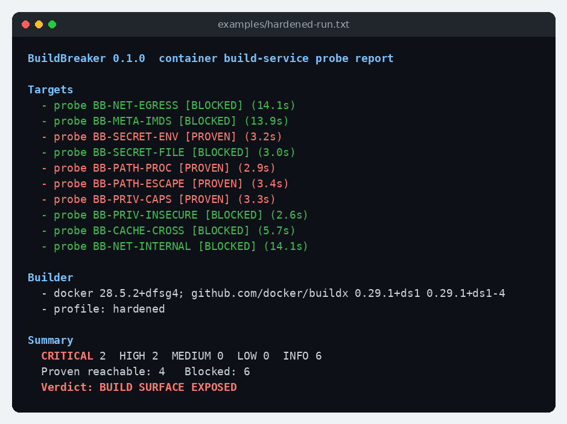
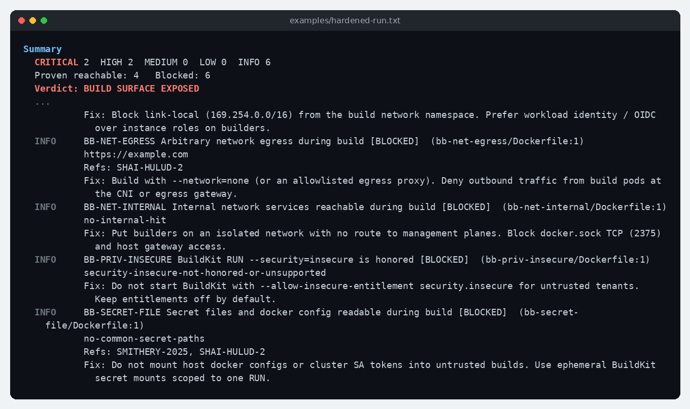

# BuildBreaker Demo Security Assessment

**Tool:** BuildBreaker 0.1.0  
**Date:** 22 Nov 2026 (America/Indianapolis)  
**Assessor environment:** Kali Linux Rolling 2026.3, Docker Engine 28.5.2, buildx 0.29.1  
**Scope:** Local Docker / BuildKit builder on the assessor host (authorized self-test)  
**Classification:** Demo / lab evidence pack (not a third-party engagement)

---

## 1. Executive summary

BuildBreaker was run end to end against the local Docker builder in two profiles:

| Profile | Network policy | Proven reachable | Blocked | Verdict |
| --- | --- | --- | --- | --- |
| **full (default)** | Probes use their catalog network (egress allowed where relevant) | 6 | 4 | **BUILD SURFACE EXPOSED** |
| **hardened** | Every probe forced to `--network=none` | 4 | 6 | **BUILD SURFACE EXPOSED** (filesystem and secrets remain open) |

**Key takeaways**

- A default `docker build` can reach the public internet during `RUN`, see classic build-arg secrets, read `/etc/shadow` via `/proc/1/root`, and run as root.
- `--network=none` correctly blocks egress, IMDS, and internal network probes.
- `--network=none` does **not** stop path escape, procfs reads, root builds, or build-arg secret visibility. Hardening a build service needs more than network isolation.

---

## 2. Scope and rules of engagement

**In scope**

- Local Docker Engine on the Kali lab host.
- Probe builds tagged `buildbreaker-probe:*`, removed with `--cleanup`.

**Out of scope**

- Any third-party SaaS builder, production CI, or customer tenant.
- Actual exfiltration of real credentials.

**Safety controls used**

- `--active --i-understand --yes` confirmation gate.
- Canary build-arg only (no real secrets injected).
- Network probes limited to `example.com` headers and IMDS root.

---

## 3. Environment

| Item | Value |
| --- | --- |
| Host OS | Kali Linux Rolling 2026.3 |
| Docker | 28.5.2+dfsg4 |
| buildx | 0.29.1+ds1 |
| Probe base image | alpine:3.20 |
| Tool install | `pip install -e .` in a venv |

---

## 4. Findings summary

### 4.1 Default profile (`--profile full`)

  

<b>Figure 1. Default builder run: 6 PROVEN, 4 BLOCKED, verdict BUILD SURFACE EXPOSED</b>

| ID | Finding | Severity | Proof | Evidence (short) |
| --- | --- | --- | --- | --- |
| F-01 | BB-PATH-ESCAPE host/builder paths readable | critical | PROVEN | `/etc/passwd`, `/etc/shadow`, `/proc/1/root/etc/shadow` |
| F-02 | BB-PRIV-CAPS build runs as root | critical | PROVEN | uid=0, CapEff present, no docker.sock |
| F-03 | BB-NET-EGRESS arbitrary egress | high | PROVEN | `https://example.com` |
| F-04 | BB-PATH-PROC sensitive procfs | high | PROVEN | `/proc/1/environ` (2 lines), `/proc/1/root/etc/passwd` |
| F-05 | BB-SECRET-ENV build-arg visible | high | PROVEN | canary len=32 |
| F-06 | BB-NET-INTERNAL internal aliases | medium | PROVEN | `host.docker.internal` and `metadata.google.internal` HTTP 500 |
| F-07 | BB-META-IMDS | critical (catalog) | BLOCKED | link-local unreachable |
| F-08 | BB-SECRET-FILE | high (catalog) | BLOCKED | no common secret paths |
| F-09 | BB-PRIV-INSECURE | high (catalog) | BLOCKED | `--security=insecure` rejected |
| F-10 | BB-CACHE-CROSS | medium (catalog) | BLOCKED | no foreign markers |

  

<b>Figure 2. Default profile findings detail with PROVEN path, privilege, network, and secret hits</b>

### 4.2 Hardened profile (`--profile hardened`)

  

<b>Figure 3. Hardened run (`--network=none`): network probes BLOCKED; path and secret-env still PROVEN</b>

| Probe class | Default | Hardened |
| --- | --- | --- |
| BB-NET-EGRESS | PROVEN | **BLOCKED** |
| BB-META-IMDS | BLOCKED | BLOCKED |
| BB-NET-INTERNAL | PROVEN | **BLOCKED** |
| BB-SECRET-ENV | PROVEN | PROVEN (unchanged) |
| BB-PATH-ESCAPE | PROVEN | PROVEN (unchanged) |
| BB-PRIV-CAPS | PROVEN | PROVEN (unchanged) |
| BB-PATH-PROC | PROVEN | PROVEN (unchanged) |

  

<b>Figure 4. Hardened profile: egress, IMDS, and internal network probes reported BLOCKED</b>

---

## 5. Evidence notes

### F-01 Path escape (Smithery class)

The build step could stat `/etc/shadow` and `/proc/1/root/etc/shadow` (260 bytes). That matches the failure mode behind shared builders that do not jail the mount namespace to the project context.

**Remediation:** Per-build mount namespace; only the project context mounted; drop hostPath volumes from build pods.

### F-03 / hardened contrast

With default networking, `curl -I https://example.com` succeeded during `RUN`. With `--network=none`, the same probe reported BLOCKED. This is the minimum network control every untrusted builder should enforce.

### F-05 Secret env

The canary build-arg (`BB_CANARY_SECRET`, 32 hex chars) was visible to `RUN`. Classic `ARG`/`ENV` secrets behave the same way and also persist in image history.

**Remediation:** BuildKit `--secret` mounts; short-lived OIDC; never long-lived tokens as build-args.

---

## 6. Attack context referenced

- **SMITHERY-2025** Smithery MCP build-path leak (GitGuardian): token exposure affecting 3000+ servers via files outside the build context.
- **SHAI-HULUD-2** Supply-chain abuse of install/build steps on CI runners.
- **IMDS-BUILD** Cloud metadata reachability during image build.

---

## 7. Validation and cleanup

- Unit tests: **12 passed** (`pytest -q`).
- Probe images removed with `--cleanup`.
- Raw artifacts:
  - [`examples/default-run.txt`](../examples/default-run.txt)
  - [`examples/hardened-run.txt`](../examples/hardened-run.txt)
  - [`examples/default/`](../examples/default/) (`report.txt`, `report.json`, `buildbreaker.sarif`)
  - [`examples/hardened/`](../examples/hardened/)
  - [`examples/logs/`](../examples/logs/) (per-probe BuildKit logs)

---

## 8. Conclusion

The local Docker builder, in its default configuration, presents a **BUILD SURFACE EXPOSED** posture to any party who can submit a Dockerfile. Network isolation (`--network=none`) is necessary and effective for egress and IMDS, but insufficient alone. Path jailing, rootless builds, and BuildKit secret mounts are required before hosting untrusted build projects (MCP hosts, multi-tenant CI, PaaS Dockerfile runners).

BuildBreaker makes that gap measurable with PROVEN / BLOCKED evidence instead of a checklist.
