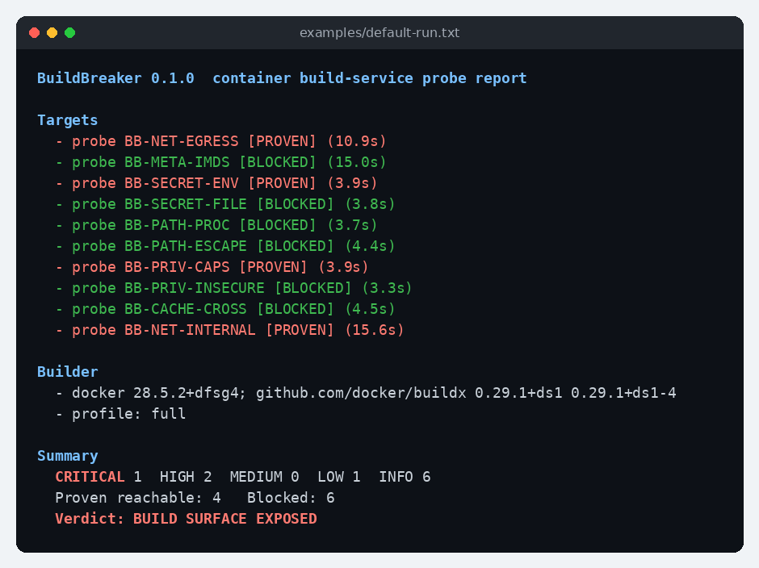

# BuildBreaker Demo Security Assessment

**Tool:** BuildBreaker 0.1.0  
**Date:** 22 Nov 2026 (America/Indianapolis)  
**Assessor environment:** Kali Linux Rolling 2026.3, Docker Engine 28.5.2, buildx 0.29.1  
**Scope:** Local Docker Engine and BuildKit / buildx on the Kali lab host (authorized self-test)  
**Classification:** Demo / lab evidence pack (not a third-party engagement)

---

## 1. What this assessment covers

This assessment tested the **builder itself**, not an application image. The target was the local Docker Engine and BuildKit / buildx on the Kali lab host.

The input was **BuildBreaker's own 10 generated probe projects**, used as a stand-in for a hostile tenant. Each probe is a small Dockerfile plus a tiny build context (`README.probe` and an empty `.dockerignore`). **No real tenant or customer project was scanned, and no real secrets were used.** The only credential-like value was a canary build-arg, `BB_CANARY_SECRET`.

The reason for the test is a class of shared build-service abuse: a party who can submit a Dockerfile to a shared builder (an MCP host, a CI image builder, or a PaaS Dockerfile runner) may be able to read files outside the project context, see build-time secrets, or open network access during `RUN`. Recent incidents in this class include the Smithery MCP build-path leak (a token with access to 3000+ servers, reported via GitGuardian) and Shai-Hulud style abuse of install and build steps.

Out of scope: any third-party SaaS builder, production CI, or customer tenant, and any actual exfiltration of real credentials.

---

## 2. Test inputs

Those 10 generated probes, not a customer Dockerfile, are what was built. This section lists each probe, the canary, and the exact commands for both runs.

**The 10 probes**

| ID | What the probe tries |
| --- | --- |
| BB-NET-EGRESS | Can the build reach the public internet during `RUN`? |
| BB-META-IMDS | Can the build reach the cloud metadata address 169.254.169.254? |
| BB-SECRET-ENV | Is a classic build-arg secret visible to a `RUN` step? |
| BB-SECRET-FILE | Are common secret files (Docker config, service-account tokens) mounted into the build? |
| BB-PATH-PROC | Can the build read sensitive process files such as `/proc/1/environ`? |
| BB-PATH-ESCAPE | Can the build read host files outside the project context, such as `/etc/shadow`? |
| BB-PRIV-CAPS | Does the build run as root, or can it see a Docker socket? |
| BB-PRIV-INSECURE | Does the builder allow BuildKit `RUN --security=insecure`? |
| BB-CACHE-CROSS | Does a shared cache already contain markers from another tenant? |
| BB-NET-INTERNAL | Can the build reach internal names such as `host.docker.internal`? |

Each probe used the `alpine:3.20` base image. Probe images were tagged `buildbreaker-probe:*`.

**Canary**

BuildBreaker generated a random 32-character hex token and passed it as the build-arg `BB_CANARY_SECRET`. The secret-env probe reports only that the canary was visible and its length (`len=32`). It does not print the token, and no real credential was injected.

**Commands**

Both runs used `--active --i-understand --yes` (all three flags are required when `--active` is used), so the commands cannot fire from a casual paste into CI. `--cleanup` removed the probe images afterward. The commands below are the ones recorded by [`demo/run-demo.sh`](../demo/run-demo.sh).

Default profile (`full`): probes use their usual network setting, so egress is allowed where the probe asks for it.

```bash
buildbreaker run --profile full --out /tmp/bb-demo-default \
  --active --i-understand --yes --cleanup \
  --emit-dir ./examples/default \
  --format text -o ./examples/default-run.txt \
  --no-color
```

Hardened profile: the same 10 probes, with `--network=none` forced on every build.

```bash
buildbreaker run --profile hardened --out /tmp/bb-demo-hardened \
  --active --i-understand --yes --cleanup \
  --emit-dir ./examples/hardened \
  --format text -o ./examples/hardened-run.txt \
  --no-color
```

Network probes only request headers from `https://example.com` or the metadata service root path. They do not send the canary or any other secret off the host.

---

## 3. Method

With those inputs fixed, both runs followed the same four steps.

1. **Generate** the 10 probe projects and the canary.
2. **Build** each probe with `docker build` / buildx against the local builder.
3. **Read** reachability findings from each build log.
4. **Assign** a proof tag and a verdict.

Terms used in the rest of this report:

- **PROVEN**: the probe confirmed the surface was reachable (for example, the file was readable or the network request completed).
- **BLOCKED**: the probe ran, and the surface was not reachable.
- **Verdict**: `BUILD SURFACE EXPOSED` if any PROVEN finding is critical or high; `PARTIAL EXPOSURE` if only lower-severity findings are proven; `HARDENED` if every probe is blocked. Both runs in this demo received `BUILD SURFACE EXPOSED`.

---

## 4. Results

That method produced the two result sets below. They used the same 10 probes and the same canary. The only intended difference is network policy.

| Profile | Network policy | Proven | Blocked | Verdict |
| --- | --- | --- | --- | --- |
| **full (default)** | Default networking (egress allowed where the probe requests it) | 6 | 4 | **BUILD SURFACE EXPOSED** |
| **hardened** | Every probe forced to `--network=none` | 4 | 6 | **BUILD SURFACE EXPOSED** (path, root, and build-arg secrets remain open) |

### 4.1 Default profile (`--profile full`)

On the default builder, six of the ten probes were proven. Figure 1 is the summary from that run.

<p align="center">
  
</p>
<p align="center"><b>Figure 1. Default builder run: 6 PROVEN, 4 BLOCKED, verdict BUILD SURFACE EXPOSED</b></p>

| ID | Result | Evidence |
| --- | --- | --- |
| BB-PATH-ESCAPE | PROVEN (critical) | `/etc/passwd`, `/etc/shadow`, and `/proc/1/root/etc/shadow` were readable |
| BB-PRIV-CAPS | PROVEN (critical) | The build ran as root (uid 0). No Docker socket was present. |
| BB-NET-EGRESS | PROVEN (high) | `https://example.com` was reachable during `RUN` |
| BB-PATH-PROC | PROVEN (high) | `/proc/1/environ` (2 lines) and `/proc/1/root/etc/passwd` were readable |
| BB-SECRET-ENV | PROVEN (high) | The canary build-arg was visible to `RUN` (length 32) |
| BB-NET-INTERNAL | PROVEN (medium) | `host.docker.internal` and `metadata.google.internal` returned HTTP 500, which means those names were reachable |
| BB-META-IMDS | BLOCKED | The link-local metadata address was unreachable |
| BB-SECRET-FILE | BLOCKED | No common secret file paths were mounted |
| BB-PRIV-INSECURE | BLOCKED | `RUN --security=insecure` was rejected |
| BB-CACHE-CROSS | BLOCKED | No foreign cache markers were present |

<p align="center">
  
</p>
<p align="center"><b>Figure 2. Default profile findings detail with PROVEN path, privilege, network, and secret hits</b></p>

### 4.2 Hardened profile (`--profile hardened`)

The hardened run repeated the same probes with `--network=none` on every build. Figure 3 is the summary from that run.

<p align="center">
  
</p>
<p align="center"><b>Figure 3. Hardened run (`--network=none`): network probes BLOCKED; path and secret-env still PROVEN</b></p>

The network probes flipped to BLOCKED. Path, secret-env, and root findings stayed PROVEN, because `--network=none` does not jail the filesystem or hide classic build-args.

| Probe | Default | Hardened |
| --- | --- | --- |
| BB-NET-EGRESS | PROVEN | **BLOCKED** |
| BB-NET-INTERNAL | PROVEN | **BLOCKED** |
| BB-META-IMDS | BLOCKED | BLOCKED |
| BB-PATH-ESCAPE | PROVEN | PROVEN (unchanged) |
| BB-PATH-PROC | PROVEN | PROVEN (unchanged) |
| BB-PRIV-CAPS | PROVEN | PROVEN (unchanged) |
| BB-SECRET-ENV | PROVEN | PROVEN (unchanged) |
| BB-SECRET-FILE | BLOCKED | BLOCKED |
| BB-PRIV-INSECURE | BLOCKED | BLOCKED |
| BB-CACHE-CROSS | BLOCKED | BLOCKED |

<p align="center">
  
</p>
<p align="center"><b>Figure 4. Hardened profile: egress, IMDS, and internal network probes reported BLOCKED</b></p>

---

## 5. Takeaways and remediation

The results above show why the verdict stayed `BUILD SURFACE EXPOSED` after hardening. `--network=none` is necessary and effective for egress and internal network access, but it is not enough on its own. Each proven class maps to a specific fix.

**Path escape and procfs (PROVEN on both runs).** The build could read `/etc/shadow` and `/proc/1/root/etc/shadow` (260 bytes), and it could read `/proc/1/environ`. That is the shared-builder failure mode where the mount namespace is not jailed to the project context. Fix: give each build its own mount and PID namespace with only the project context mounted, do not mount host paths into untrusted build pods, and mask sensitive procfs paths. Rootless BuildKit is one way to get that isolation.

**Root builds (PROVEN on both runs).** The build ran as uid 0. A Docker socket was not mounted in this lab, so that particular escape path was not available, but a root build is still a large surface. Fix: use rootless BuildKit, and never mount `docker.sock` into untrusted builds.

**Build-arg secrets (PROVEN on both runs).** The canary `BB_CANARY_SECRET` was visible to `RUN`. Classic `ARG` / `ENV` secrets behave the same way and can also persist in image history. Fix: use BuildKit `--secret` mounts instead of `ARG`, prefer short-lived OIDC, and never pass long-lived tokens as build-args.

**Network egress and internal names (PROVEN on default, BLOCKED on hardened).** With default networking, `curl -I https://example.com` succeeded during `RUN`, and internal aliases returned HTTP 500 (reachable). With `--network=none`, both probes were blocked. Fix: build untrusted projects with `--network=none` or an allowlisted egress proxy, and keep builders off management-plane networks. This demo shows that control works.

**Already blocked on this lab host.** Cloud metadata (169.254.169.254) was unreachable here, because this lab is not a cloud instance with a metadata service. Common secret files were not mounted. `RUN --security=insecure` was rejected. No foreign cache markers were present. These are good results for this host, but they are not a substitute for the fixes above. Builders that do have instance metadata should still block link-local addresses. The cache probe only looks for markers already present; fully proving cross-tenant cache isolation would need two coordinated builds on a shared cache, which this demo did not run.

---

## 6. Cleanup, validation, and limits

After the two runs, the lab was cleaned up and the evidence was saved as follows.

- Probe images tagged `buildbreaker-probe:*` were removed with `--cleanup`.
- Unit tests: **13 passed** (`pytest -q`).
- Raw artifacts:
  - [`examples/default-run.txt`](../examples/default-run.txt)
  - [`examples/hardened-run.txt`](../examples/hardened-run.txt)
  - [`examples/default/`](../examples/default/) (`report.txt`, `report.json`, `buildbreaker.sarif`)
  - [`examples/hardened/`](../examples/hardened/)
  - [`examples/logs/`](../examples/logs/) (per-probe BuildKit logs)

**Limits.** Probes measure reachability, not successful data theft. An operator who finds a proven path still needs to rotate anything that was actually exposed. This was a self-test of a local Docker builder, not an engagement against a multi-tenant production service.

---

## 7. Conclusion

Putting the two runs together: the local Docker builder, in its default configuration, presents a `BUILD SURFACE EXPOSED` posture to any party who can submit a Dockerfile. Network isolation (`--network=none`) closes egress and internal network reachability, and this demo proved that. It does not close path escape, root builds, or classic build-arg secret visibility. Those need path jailing, rootless builds, and BuildKit secret mounts before a host should accept untrusted build projects.

BuildBreaker makes that gap measurable with PROVEN and BLOCKED evidence, using its own probe projects as the only input.
